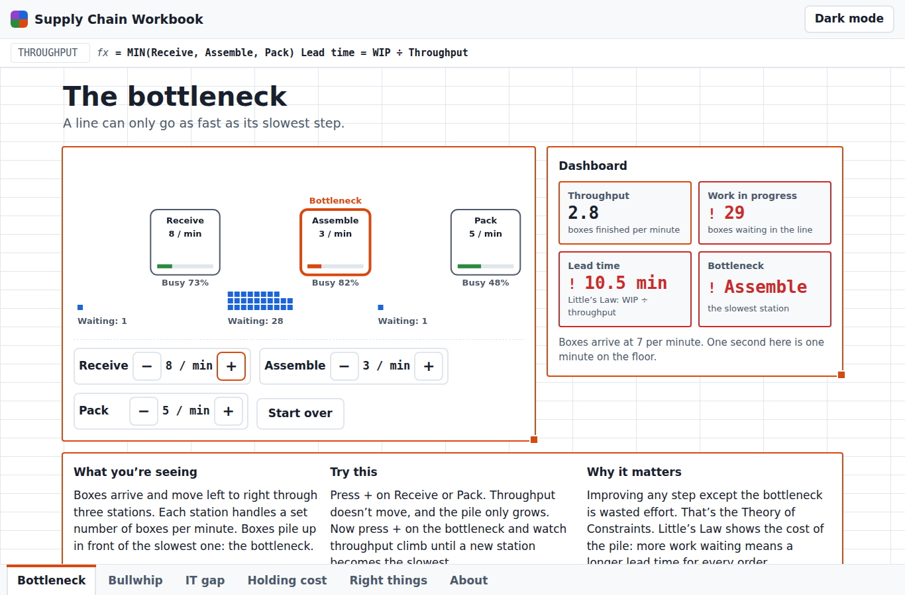
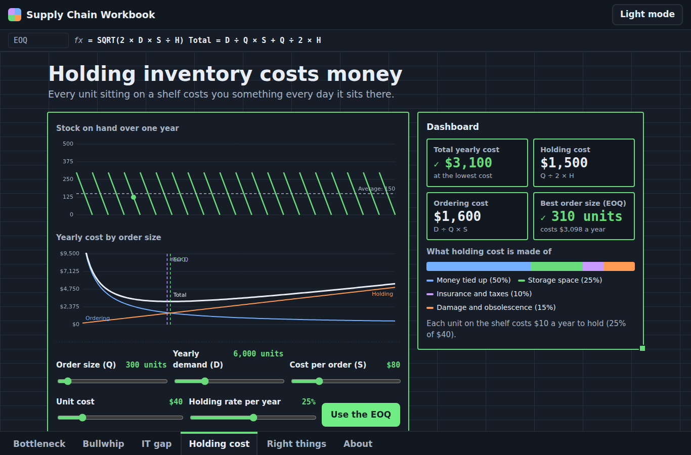
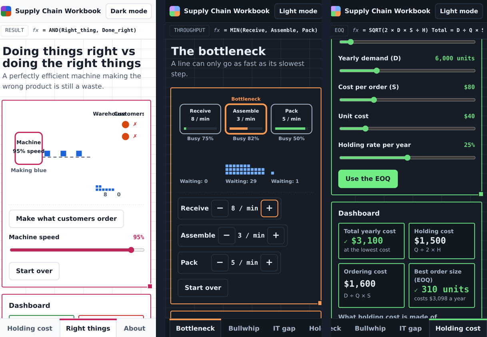

# Supply Chain Workbook

**Supply chain ideas you can see, test and question.** A living spreadsheet where each sheet tab is one supply chain lesson: an animation you can play with, a dashboard that recalculates, and a plain-language explanation.

**[Open the workbook](https://markfourman.github.io/supply-chain-workbook/)** — works on desktop and phone, in light or dark mode. You'll answer one skill-testing question first.

## The sheets

| Sheet | The idea | What you can do |
| --- | --- | --- |
| **Bottleneck** | A line only moves as fast as its slowest step (Theory of Constraints), and Little's Law turns the waiting pile into lead time. | Speed stations up or down and watch boxes pile up in front of the slowest one. |
| **Bullwhip** | A small change in customer demand becomes a huge swing at the factory. | Change the size of the demand jump, then share real sales data with every tier and see the swing shrink. |
| **IT gap** | When every team keeps its own spreadsheet, nobody sees the same stock. | Watch broken promises and stockouts add up, then connect every team to one ERP. |
| **Holding cost** | Every unit on the shelf costs money; the economic order quantity (EOQ) finds the cheapest balance between ordering and holding. | Change order size, demand and costs, and snap to the EOQ. |
| **Right things** | Doing things right (efficiency) isn't the same as doing the right things (effectiveness). | Run a machine flat out on the wrong product, then switch to making what customers order and see which row of the truth table you land in. |
| **About** | Who built this and how. | |

## Why it looks like a spreadsheet

Spreadsheets are where most supply chain decisions really get made. Each sheet has a formula bar showing the logic behind it (`= MIN(Receive, Assemble, Pack)`, `= SQRT(2 × D × S ÷ H)`), dashboard tiles that recalculate as you play, and a coloured outline like the ranges a spreadsheet highlights when you edit a formula.

The skill-testing question at the door is a nod to Canadian contests, and a quick check of order of operations (BEDMAS). Get it wrong and it shows you the steps.

## Built for everyone

- Plain language first, with the technical term second.
- Light and dark mode, saved for your next visit.
- Works with a keyboard (arrow keys move between sheet tabs) and a screen reader; colours are always paired with text or symbols.
- Responsive from a small phone to a big monitor.

## How it's built

Plain HTML, CSS and JavaScript, with no frameworks and nothing to install. Every number is simulated live in the browser. Each lesson is one self-contained object registered with the workbook, so adding a new sheet means adding one block of code.

| File | What it does |
| --- | --- |
| `js/app.js` | The skill-testing question, theme switch, sheet tabs, dashboard tiles and the animation loop. |
| `js/sheets-flow.js` | The bottleneck, bullwhip and IT gap lessons. |
| `js/sheets-cost.js` | The holding cost and EOQ, right-things and About sheets. |
| `css/style.css` | The spreadsheet look, light and dark themes, and phone layout. |

## Run it or publish it

- **On your computer:** download the repository and double-click `index.html`.
- **On GitHub Pages:** in the repository, open **Settings → Pages**, deploy from the `main` branch and `/ (root)`. The site appears at `https://YOUR-USERNAME.github.io/supply-chain-workbook/`.
- Replace `YOUR-USERNAME`, `YOUR NAME` and `YOUR-PROFILE` in `index.html`, `js/sheets-cost.js`, this README and `LICENSE`.

## About me

Former high school math and science teacher, now studying Supply Chain Management (Global Logistics) at Seneca College, with hands-on experience in inventory management and freight forwarding. Tools: Excel (Power Query, VBA), Power BI, Tableau, SAP S/4HANA and Access. See also [Cargo Voyage](https://YOUR-USERNAME.github.io/cargo-voyage/), which follows one shipment into Canada by sea or air.

The simulations are simplified for teaching; real supply chains have more moving parts.

## License

MIT. Built by YOUR NAME.
